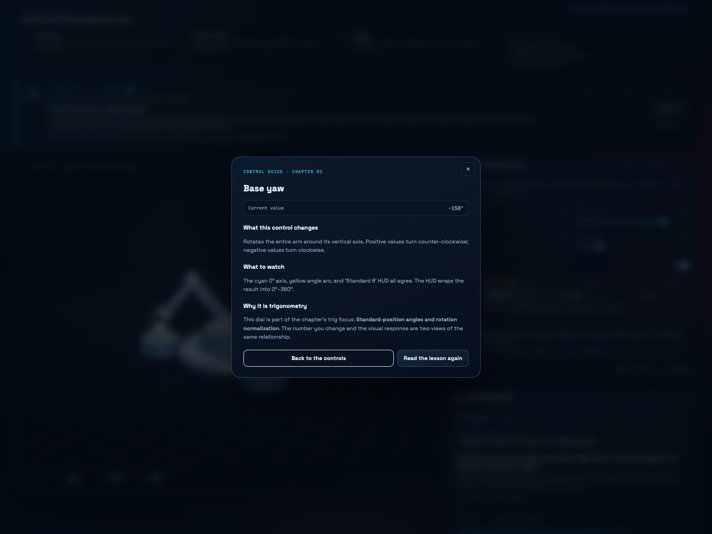
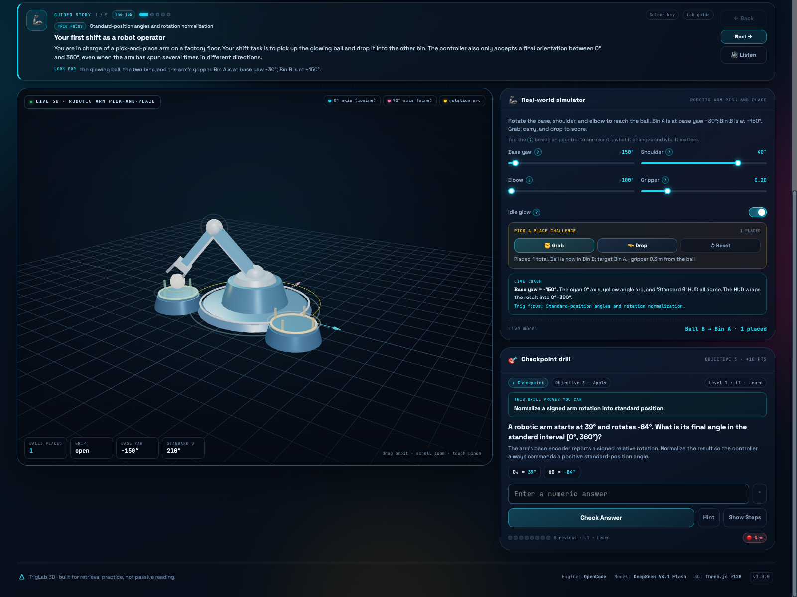
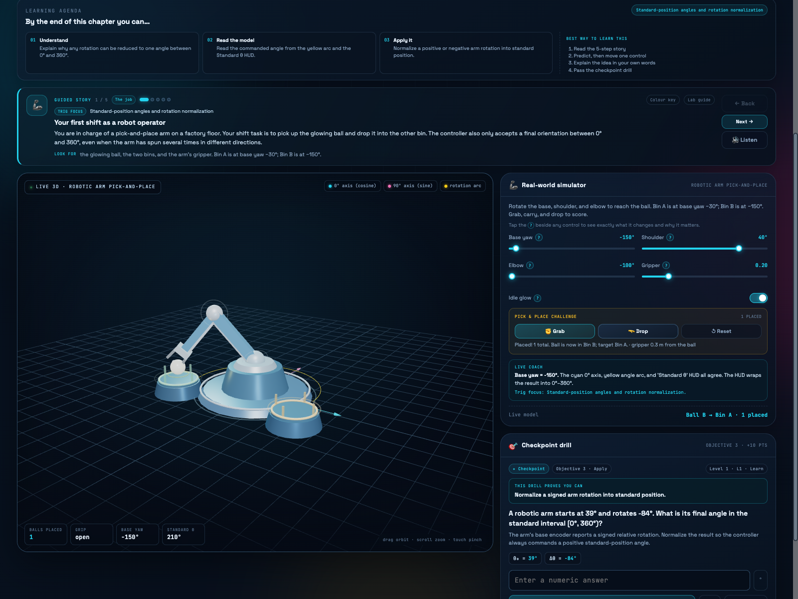

# TrigLab 3D — 20-Tab Trigonometry Master Booklet & SRS Learning Studio

A static, production-ready trigonometry laboratory built with **vanilla HTML5, CSS3, ES6 JavaScript, and Three.js r128**. Twenty interactive 3D engineering simulators are paired with fresh generative exercises and a portable spaced-repetition system. No build step, no backend, no dependencies beyond CDN scripts.

**Live demo:** <https://somphol.github.io/3d-trigonometry-master-booklet/>

[](https://somphol.github.io/3d-trigonometry-master-booklet/)

## What it is

TrigLab 3D is a complete 20-chapter trigonometry booklet where each chapter has:

- A **live 3D viewport** with OrbitControls, neon geometry, and a real-world engineering simulator.
- A **learning agenda** with three measurable objectives and a recommended study sequence.
- A **five-step guided lesson** with optional read-aloud narration: the job, the scene, the trig idea, the formula in action, and a guided experiment.
- **Per-control help**: tap the `?` beside any dial to see what it changes, what to watch, and why it is trigonometry. A **live coach** explains the result after every adjustment.
- A **generative checkpoint** with progressive hints, misconception feedback, a worked solution, and an **explain-it-back** prompt.
- **SRS metadata** per chapter: status, last reviewed timestamp, review count, and next review due.

The UI uses a dark STEM-laboratory theme with glassmorphism panels, cyan/magenta/yellow signal colours, and a scrollable 20-tab curriculum rail. It is fully responsive and works as a read-only GitHub Pages site.

**Colour semantics are chapter-specific.** Cyan and magenta only mean cosine/sine when the chapter is actually projecting a direction into components. Elsewhere the key names the real object (a ray, a trace, a panel edge). Chapter 1 makes this explicit: the robot joints are neutral, while the cyan 0° axis, magenta 90° axis, and yellow rotation arc carry the mathematical meaning.

## Learning design

The lesson structure is deliberately aligned with evidence-based practice:

| Principle | How TrigLab applies it |
|---|---|
| **Concrete → Representational → Abstract (CRA)** | Drive a 3D real-world simulator (concrete), read the colour keys/HUD/formula decoder (representational), then solve the symbolic checkpoint (abstract). |
| **Predict–Observe–Explain (POE)** | The final story step asks for a prediction before moving a control; the live coach explains the observation; the correct-answer **Explain it back** prompt completes the explanation phase. |
| **Cognitive load & worked examples** | The lesson is chunked into five short steps, controls have just-in-time help, hints progress from concept → formula → first step, and a full worked solution is available after effort. |
| **Retrieval practice & spacing** | Every chapter ends in a generative checkpoint aligned to objective 3; successful retrieval schedules the next review at 1, 3, 7, or 30 days. |
| **Misconception-aware feedback** | Wrong answers surface a chapter-specific **Common trap** note, such as swapping sine/cosine or forgetting to normalize an angle. |
| **Metacognition** | The agenda states the success criteria, and the explain-it-back prompt asks learners to restate the idea in their own words. |
| **Embodied practice** | Chapter 1 is a working pick-and-place game: set the base angle, lower the arm, grab the ball from one bin, carry it to the other, and drop it. The game uses the same angle concepts as the checkpoint. |

Research consulted:

- [Concrete–Representational–Abstract (CRA) instructional sequence](https://www.pattan.net/getmedia/9059e5f0-7edc-4391-8c8e-ebaf8c3c95d6/CRA_Methods0117) and [Edutopia's CRA overview](https://www.edutopia.org/article/using-cra-framework-elementary-math/).
- [Predict–Observe–Explain in science education (MDPI)](https://www.mdpi.com/2673-8392/6/11/242) and [an ERIC study of POE instruction](https://files.eric.ed.gov/fulltext/EJ1341654.pdf).
- [Cognitive load theory in practice (NSW CESE)](https://education.nsw.gov.au/content/dam/main-education/about-us/educational-data/cese/2017-cognitive-load-theory-practice-guide.pdf) and [worked-example research summary](https://www.structural-learning.com/post/cognitive-load-theory-a-teachers-guide).
- [Retrieval practice as a classroom routine (Edutopia)](https://www.edutopia.org/video/making-retrieval-practice-a-classroom-routine/).
- [Understandings and misunderstandings of trigonometry (Williams)](https://www.gcsu.edu/sites/files/page-assets/node-808/attachments/williams.pdf) and [students' trigonometry misconceptions (Orhun)](https://sites.unipa.it/grim/AOrhun.PDF).

## New learner guidance

No prior trigonometry is assumed.

- **Learning agenda on every chapter** — three objectives state exactly what you should be able to understand, read from the model, and apply. A four-step study sequence shows the most effective order.
- **Five-step guided story** — the job, what you are looking at, the trig idea in everyday words, the formula in action, and a guided “your turn” experiment.
- **Read-aloud narration** — the **🔊 Listen** button reads the current story step using the browser's speech synthesis.
- **Clickable colour keys** — the cyan/magenta/yellow chips in the viewport are buttons. Tap one for a plain-English definition plus what that colour is doing in this simulator. On phones, use the **Colour key** button above the scene.
- **Control guides and live coach** — tap the `?` beside any control for a plain-English explanation; move it and the live coach tells you what changed and what to watch.
- **Formula decoder** — tap the formula pill beside the chapter title for a symbol-by-symbol explanation in everyday language.
- **Progressive hints and common-trap feedback** — hints move from concept to formula to first step, and wrong answers name the misconception rather than only saying “try again.”
- **Explain it back** — after a correct checkpoint, restate the idea in your own words and compare with a model answer.
- **Pick-and-place challenge** — Chapter 1 is playable: use the base, shoulder, and elbow to grab a glowing ball from one bin and drop it into the other. The game reuses the chapter's angle concepts and keeps score.
- **One-time welcome briefing** — first-time visitors get a short introduction to the agenda → story → model → checkpoint loop.

[](screenshot.png) [](screenshot-control.png)

[](screenshot-checkpoint.png) [](screenshot-arm.png)

## Curriculum map

| # | Chapter | Real-world simulator | Core idea |
|---:|---|---|---|
| 01 | Angles & Rotations | Robotic Arm Pick-and-Place | Standard-position angles, signed rotations, and a playable ball-transfer game |
| 02 | Radians vs. Degrees | Vehicle Speedometer & Tire RPM | `v = ωr`, RPM → rad/s → km/h |
| 03 | SOH CAH TOA Basics | Skyscraper Clinometer Estimator | `tan θ = opposite / adjacent` |
| 04 | Reciprocal Ratios | Optical Refraction & Lens Design | Reciprocal identities and Snell's law |
| 05 | Inverse Trig Functions | Wheelchair Ramp Safety Inspector | `θ = arctan(rise / run)`, ADA limits |
| 06 | 3D Unit Circle | Game Character Joystick Engine | `(cos θ, sin θ)` and tangent |
| 07 | ASTC Quadrants | Air Traffic Control Radar | Signs of trig functions by quadrant |
| 08 | Special Right Triangles | Roof Truss Timber Calculator | 30-60-90 and 45-45-90 ratios |
| 09 | Unrolling Sine | AC Electrical Generator | `v(t) = Vp sin(2πft)`, RMS |
| 10 | Unrolling Cosine | Clock Pendulum Motion Tracker | `x = L sin θ`, simple harmonic motion |
| 11 | Tangent & Asymptotes | Lighthouse Shoreline Beam | `tan θ` growth toward 90° |
| 12 | Wave Amplitude & Period | Radio Station Signal Tuner | Period, amplitude, `λ = c/f` |
| 13 | Phase Shift | Active Noise Cancellation | Superposition, `2A cos(φ/2)` |
| 14 | Law of Sines | River Width Land Surveyor | Triangulating an inaccessible width |
| 15 | Ambiguous Case (SSA) | Coast Guard Interception | 0, 1, or 2 triangles |
| 16 | Law of Cosines | Aviation Distance & Wind Drift | `c² = a² + b² − 2ab cos C` |
| 17 | Pythagorean Identity | Shader & Surface Lighting Normalizer | `sin²θ + cos²θ = 1` |
| 18 | Double Angle Formulas | Projectile Cannon Maximizer | `R = v² sin 2θ / g`, 45° optimum |
| 19 | 3D Vectors & Cross Products | Solar Panel Sun-Tracking Engine | `|a × b| = |a||b| sin θ` |
| 20 | Spherical Coordinates | GPS Satellite & Flight Navigator | `r, φ, λ` → Cartesian coordinates |

## Spaced repetition engine

Every completed drill logs a review. The interval expands with each successful retrieval:

| Level | Review count | Status | Next review |
|---|---|---|---|
| L1 · Learn | 1st | Practicing | +1 day |
| L2 · Practicing | 2nd–3rd | Practicing | +3 days |
| L3 · Reinforcing | 4th–5th | Practicing | +7 days |
| L4 · Mastered | 6+ | Mastered | +30 days |

- **🟢 Mastered**, **🟡 Review due**, **🔴 New**, **🔵 Practicing (not due)**.
- **Due Today 🔔** dims chapters that are not due and highlights amber due chapters.
- The header tracks mastered count, due count, total reviews, score, and curriculum progress.
- Progress is saved to `localStorage` automatically after every review.

### Portable progress files

- **💾 Save Progress File** downloads `trig_srs_progress.json` containing tab statuses, ISO timestamps, review counts, `nextReviewDue`, score, and total reviews.
- **📂 Load Progress File** validates and restores that JSON on any device. Imported timestamps and review counts immediately re-drive badges, the Due filter, and the SRS summary.

## Run locally

The app is static. From the project folder:

```bash
python3 -m http.server 8123
# open http://localhost:8123/
```

You can also open `index.html` directly, though a local server is recommended because browsers may restrict `localStorage`/history on `file://`.

### GitHub Pages

1. Push the repository.
2. **Settings → Pages → Build and deployment → Deploy from a branch**.
3. Choose `main` and `/ (root)`.

All paths are relative and there is no build output. Three.js and OrbitControls load from public CDNs:

- `https://cdnjs.cloudflare.com/ajax/libs/three.js/r128/three.min.js`
- `https://cdn.jsdelivr.net/npm/three@0.128.0/examples/js/controls/OrbitControls.js`

If the 3D engine cannot load, the drills and SRS still work and a clear fallback message appears.

## Project structure

```text
.
├── index.html                 # Shell, header, controls, boot screen, CDN scripts
├── style.css                  # Dark STEM design system + responsive layout
├── script.js                  # 20 modules, scenes, guided stories, SRS, grading, import/export
├── screenshot.png             # Chapter 01 — agenda, five-step story, live coach
├── screenshot-welcome.png     # First-visit learner briefing
├── screenshot-control.png     # Per-control explanation pop-up
├── screenshot-checkpoint.png  # Checkpoint aligned to objective 3
├── screenshot-arm.png         # Chapter 01 pick-and-place challenge
├── screenshot-key.png         # Plain-English colour-key pop-up
├── screenshot-formula.png     # Formula decoder
├── screenshot-mobile.png      # Responsive guided-story layout
├── screenshot-truss.png       # Chapter 08 — roof truss
├── screenshot-globe.png       # Chapter 20 — GPS globe
├── STATE.md                   # Build duration, token usage, and credits
├── state.json                 # Machine-readable build state
├── LICENSE                    # MIT
└── THIRD_PARTY_NOTICES.md
```

## Controls

- **Drag** to orbit, **scroll / pinch** to zoom, **right-drag** to pan.
- Sliders, selects, and toggles update the live model and HUD instantly.
- `Enter` submits a numeric answer; `Esc` closes dialogs; `Alt + ←/→` moves between chapters.
- Tab buttons support roving focus and `ArrowLeft` / `ArrowRight`.

## Verification

The shipped build was exercised in headless Chrome across all 20 tabs:

- 20/20 panels render with a learning agenda, five-step guided story, live WebGL canvas, HUD, control guides, live coach, and generated checkpoint.
- 20/20 agendas show three measurable objectives and the recommended study sequence.
- 100/100 story steps were walked through; 60/60 colour-key pop-ups and 20/20 formula decoders opened with the correct labels and plain-English content.
- 60/60 control-guide pop-ups were verified, and the live coach updated with the correct observation after real slider changes.
- 20/20 generative checkpoints solved through the real UI; grading, progressive hints, misconception feedback, explain-it-back, scores, review counts, status transitions, and timestamps were verified.
- Chapter 1's pick-and-place game was played through to a successful placement: grab, carry, drop, score increment, HUD update, and the next-ball swap all verified.
- Chapter 7 reference angles, Chapter 4 reciprocal-ratio checkpoints, and Chapter 19 dot-product/cross-product outputs were spot-checked against their formulas.
- JSON import round-trip verified, including score, badges, due count, and `localStorage` persistence.
- No uncaught exceptions or console errors.
- Responsive layout checked at 390 × 844 and 1600 × 1200.

## Credits

Built with **[OpenCode](https://opencode.ai)** and **DeepSeek V4.1 Flash** (`opencode-go/deepseek-v4.1-flash`). Build duration and token usage are recorded in [STATE.md](STATE.md) and [state.json](state.json).

3D powered by [Three.js](https://threejs.org/) r128 and OrbitControls by mrdoob and contributors. Typography: Space Grotesk and JetBrains Mono via Google Fonts (SIL Open Font License).

## License

MIT — see [LICENSE](LICENSE).
