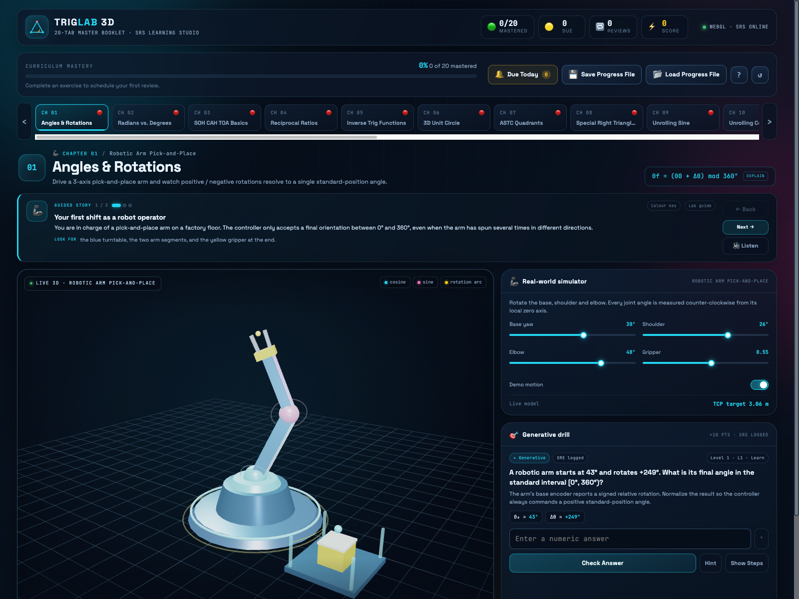
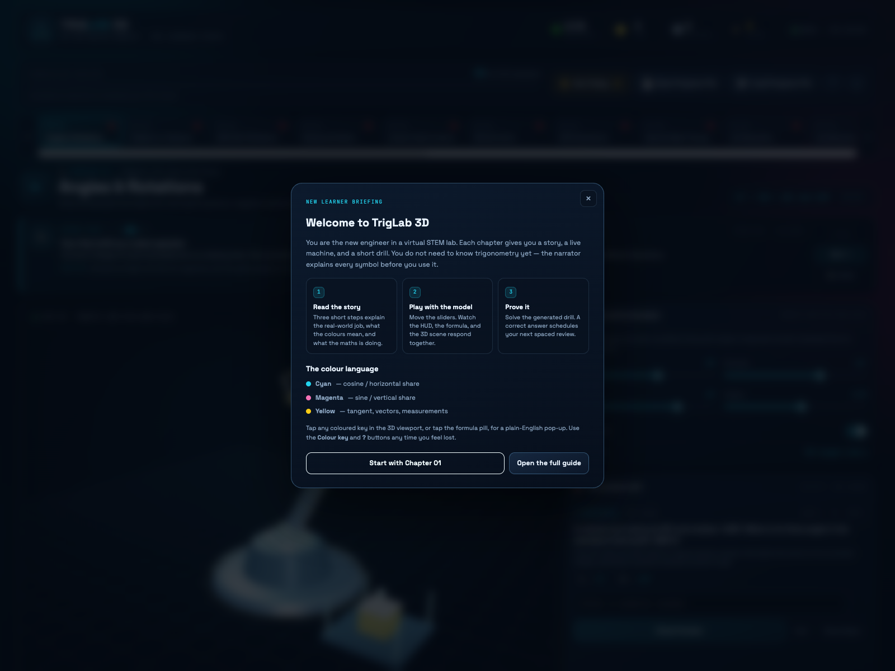
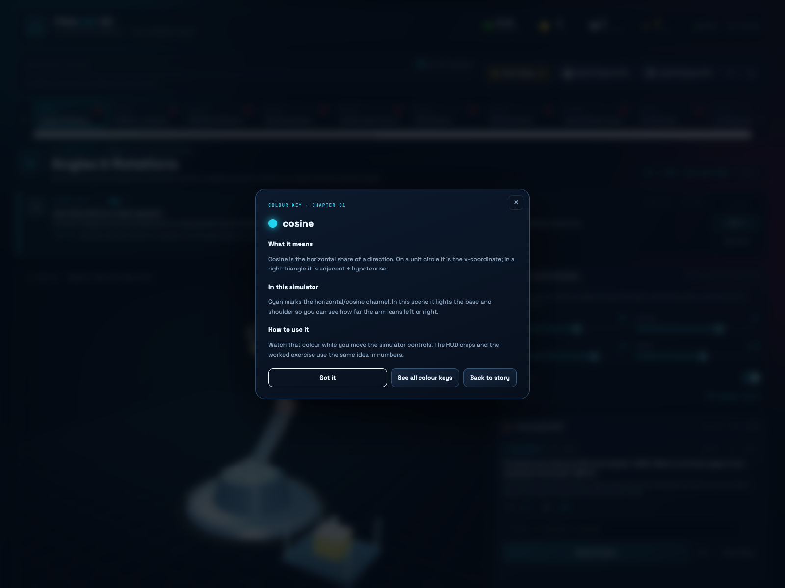

# TrigLab 3D — 20-Tab Trigonometry Master Booklet & SRS Learning Studio

A static, production-ready trigonometry laboratory built with **vanilla HTML5, CSS3, ES6 JavaScript, and Three.js r128**. Twenty interactive 3D engineering simulators are paired with fresh generative exercises and a portable spaced-repetition system. No build step, no backend, no dependencies beyond CDN scripts.

**Live demo:** <https://somphol.github.io/3d-trigonometry-master-booklet/>

[](https://somphol.github.io/3d-trigonometry-master-booklet/)

## What it is

TrigLab 3D is a complete 20-chapter trigonometry booklet where each chapter has:

- A **live 3D viewport** with OrbitControls, neon geometry, and a real-world engineering simulator.
- **Simulator controls** that update the model, HUD readouts, formulas, and the drill in real time.
- A **generative exercise** with instant grading, a hint, a full worked solution, and review tracking.
- **SRS metadata** per chapter: status, last reviewed timestamp, review count, and next review due.

The UI uses a dark STEM-laboratory theme with glassmorphism panels, cyan/magenta/yellow signal colours, and a scrollable 20-tab curriculum rail. It is fully responsive and works as a read-only GitHub Pages site.

## New learner guidance

No prior trigonometry is assumed.

- **Guided story on every chapter** — three short steps explain the real-world job, what the 3D colours mean, and what the formula is doing before you touch a control.
- **Read-aloud narration** — the **🔊 Listen** button reads the current story step using the browser's speech synthesis.
- **Clickable colour keys** — the cyan/magenta/yellow chips in the viewport are buttons. Tap one for a plain-English definition plus what that colour is doing in this simulator. On phones, use the **Colour key** button above the scene.
- **Formula decoder** — tap the formula pill beside the chapter title for a symbol-by-symbol explanation in everyday language.
- **One-time welcome briefing** — first-time visitors get a short introduction to the story → model → drill loop and the colour language.
- **Worked solutions and hints** remain available in every drill, so a wrong answer is a learning step rather than a dead end.

[](screenshot-welcome.png) [](screenshot-key.png)

## Curriculum map

| # | Chapter | Real-world simulator | Core idea |
|---:|---|---|---|
| 01 | Angles & Rotations | Robotic Arm Pick-and-Place | Standard-position angles and signed rotations |
| 02 | Radians vs. Degrees | Vehicle Speedometer & Tire RPM | `v = ωr`, RPM → rad/s → km/h |
| 03 | SOH CAH TOA Basics | Skyscraper Clinometer Estimator | `tan θ = opposite / adjacent` |
| 04 | Reciprocal Ratios | Optical Refraction & Lens Design | Reciprocal identities and Snell's law |
| 05 | Inverse Trig Functions | Wheelchair Ramp Safety Inspector | `θ = arctan(rise / run)`, ADA limits |
| 06 | 3D Unit Circle | Game Character Joystick Engine | `(cos θ, sin θ)` and tangent |
| 07 | ASTC Quadrants | Air Traffic Control Radar | Signs of trig functions by quadrant |
| 08 | Special Right Triangles | Roof Truss Timber Calculator | 30-60-90 and 45-45-90 ratios |
| 09 | Unrolling Sine | AC Electrical Generator | `v(t) = Vp sin(2πft)`, RMS |
| 10 | Unrolling Cosine | Clock Pendulum Motion Tracker | `x = L sin θ`, simple harmonic motion |
| 11 | Tangent & Asymptotes | Lighthouse Shoreline Beam | `tan θ` growth toward 90° |
| 12 | Wave Amplitude & Period | Radio Station Signal Tuner | Period, amplitude, `λ = c/f` |
| 13 | Phase Shift | Active Noise Cancellation | Superposition, `2A cos(φ/2)` |
| 14 | Law of Sines | River Width Land Surveyor | Triangulating an inaccessible width |
| 15 | Ambiguous Case (SSA) | Coast Guard Interception | 0, 1, or 2 triangles |
| 16 | Law of Cosines | Aviation Distance & Wind Drift | `c² = a² + b² − 2ab cos C` |
| 17 | Pythagorean Identity | Shader & Surface Lighting Normalizer | `sin²θ + cos²θ = 1` |
| 18 | Double Angle Formulas | Projectile Cannon Maximizer | `R = v² sin 2θ / g`, 45° optimum |
| 19 | 3D Vectors & Cross Products | Solar Panel Sun-Tracking Engine | `|a × b| = |a||b| sin θ` |
| 20 | Spherical Coordinates | GPS Satellite & Flight Navigator | `r, φ, λ` → Cartesian coordinates |

## Spaced repetition engine

Every completed drill logs a review. The interval expands with each successful retrieval:

| Level | Review count | Status | Next review |
|---|---|---|---|
| L1 · Learn | 1st | Practicing | +1 day |
| L2 · Practicing | 2nd–3rd | Practicing | +3 days |
| L3 · Reinforcing | 4th–5th | Practicing | +7 days |
| L4 · Mastered | 6+ | Mastered | +30 days |

- **🟢 Mastered**, **🟡 Review due**, **🔴 New**, **🔵 Practicing (not due)**.
- **Due Today 🔔** dims chapters that are not due and highlights amber due chapters.
- The header tracks mastered count, due count, total reviews, score, and curriculum progress.
- Progress is saved to `localStorage` automatically after every review.

### Portable progress files

- **💾 Save Progress File** downloads `trig_srs_progress.json` containing tab statuses, ISO timestamps, review counts, `nextReviewDue`, score, and total reviews.
- **📂 Load Progress File** validates and restores that JSON on any device. Imported timestamps and review counts immediately re-drive badges, the Due filter, and the SRS summary.

## Run locally

The app is static. From the project folder:

```bash
python3 -m http.server 8123
# open http://localhost:8123/
```

You can also open `index.html` directly, though a local server is recommended because browsers may restrict `localStorage`/history on `file://`.

### GitHub Pages

1. Push the repository.
2. **Settings → Pages → Build and deployment → Deploy from a branch**.
3. Choose `main` and `/ (root)`.

All paths are relative and there is no build output. Three.js and OrbitControls load from public CDNs:

- `https://cdnjs.cloudflare.com/ajax/libs/three.js/r128/three.min.js`
- `https://cdn.jsdelivr.net/npm/three@0.128.0/examples/js/controls/OrbitControls.js`

If the 3D engine cannot load, the drills and SRS still work and a clear fallback message appears.

## Project structure

```text
.
├── index.html                 # Shell, header, controls, boot screen, CDN scripts
├── style.css                  # Dark STEM design system + responsive layout
├── script.js                  # 20 modules, scenes, guided stories, SRS, grading, import/export
├── screenshot.png             # Chapter 01 — guided story and robotic arm
├── screenshot-welcome.png     # First-visit learner briefing
├── screenshot-key.png         # Plain-English colour-key pop-up
├── screenshot-formula.png     # Formula decoder
├── screenshot-mobile.png      # Responsive guided-story layout
├── screenshot-truss.png       # Chapter 08 — roof truss
├── screenshot-globe.png       # Chapter 20 — GPS globe
├── STATE.md                   # Build duration, token usage, and credits
├── state.json                 # Machine-readable build state
├── LICENSE                    # MIT
└── THIRD_PARTY_NOTICES.md
```

## Controls

- **Drag** to orbit, **scroll / pinch** to zoom, **right-drag** to pan.
- Sliders, selects, and toggles update the live model and HUD instantly.
- `Enter` submits a numeric answer; `Esc` closes dialogs; `Alt + ←/→` moves between chapters.
- Tab buttons support roving focus and `ArrowLeft` / `ArrowRight`.

## Verification

The shipped build was exercised in headless Chrome across all 20 tabs:

- 20/20 panels render, each with a live WebGL canvas, four HUD chips, simulator controls, a three-step guided story, three colour keys, a formula decoder, and a generated drill.
- 20/20 colour-key pop-ups and formula decoders open with the correct chapter label and plain-English content.
- 20/20 generative exercises solved through the real UI; grading, worked solutions, score increments, review counts, status transitions, and next-review timestamps verified.
- JSON import round-trip verified, including score, badges, due count, and `localStorage` persistence.
- No uncaught exceptions or console errors.
- Responsive layout checked at 390 × 844 and 1600 × 1200.

## Credits

Built with **[OpenCode](https://opencode.ai)** and **DeepSeek V4.1 Flash** (`opencode-go/deepseek-v4.1-flash`). Build duration and token usage are recorded in [STATE.md](STATE.md) and [state.json](state.json).

3D powered by [Three.js](https://threejs.org/) r128 and OrbitControls by mrdoob and contributors. Typography: Space Grotesk and JetBrains Mono via Google Fonts (SIL Open Font License).

## License

MIT — see [LICENSE](LICENSE).
